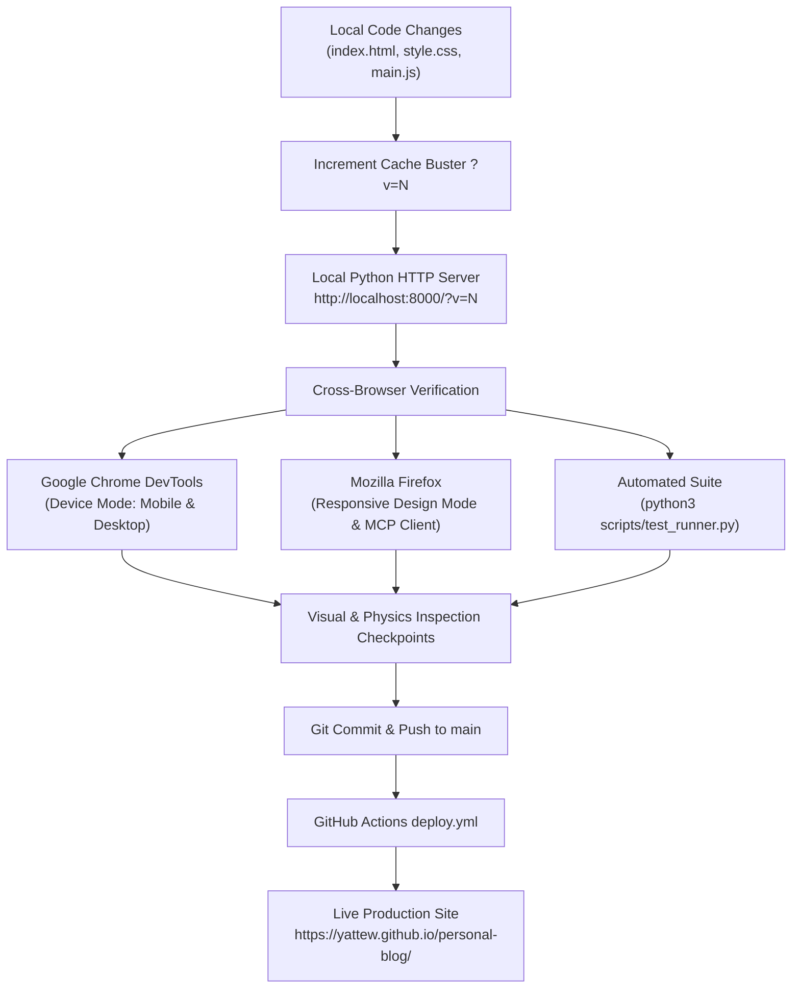

# Testing Guide: Personal Blog & 35mm Film Portfolio

This document provides the standard operating procedures, cross-browser verification matrix, and automated tooling workflows for testing the 35mm film reel portfolio site.

---

## 1. Overview & Architecture Principles

The site is built with a **Zero-Build Frontend Architecture**:
- **Vanilla ES Modules & CSS3**: Pure modern HTML5 ([`index.html`](file:///Users/yattew/Desktop/personal-blog/index.html)), CSS3 ([`css/style.css`](file:///Users/yattew/Desktop/personal-blog/css/style.css)), and ES Modules ([`js/main.js`](file:///Users/yattew/Desktop/personal-blog/js/main.js), [`config.js`](file:///Users/yattew/Desktop/personal-blog/config.js)). No bundler overhead (Webpack/Vite/Rollup).
- **Continuous Deployment**: Automated native GitHub Actions deployment on every push to `main` ([`.github/workflows/deploy.yml`](file:///Users/yattew/Desktop/personal-blog/.github/workflows/deploy.yml)).
- **Live URL**: `https://yattew.github.io/personal-blog/`
- **Dynamic Physics & SVG Generation**: Real-time calculated film leader tongues, 38px continuous sprocket perforation tracks, 4:3 aperture framing, and dual-layer ambient mesh crossfading.



---

## 2. Local Environment Setup

Run a local HTTP server in the repository root:

```bash
# Option 1: Native Python HTTP Server (Recommended)
python3 -m http.server 8000

# Option 2: Node.js static server
npx serve .
```

Open your browser to:
```
http://localhost:8000/?v=63
```

> [!IMPORTANT]
> **Cache-Busting Requirement**: Always append a cache-buster query parameter (e.g. `?v=63`) when testing local changes. The browser aggressively caches ES Modules and CSS stylesheets. When making layout or script updates, increment the version in [`index.html`](file:///Users/yattew/Desktop/personal-blog/index.html) and your test URL.

---

## 3. Viewport & Aspect Ratio Testing Matrix

The layout seamlessly shifts between **Desktop Horizontal Ribbon** and **Mobile Vertical Film Strip**. Always verify both modes across these standard viewports:

| Device / Form Factor | Viewport (W × H) | Aspect Ratio | Orientation | Expected Film Orientation |
| :--- | :--- | :--- | :--- | :--- |
| **iPhone 14 / 15 / 16 Pro** | `393 × 852` px | ~9:19.5 | Portrait | **Vertical Film Strip** (~90% screen width, top leader tongue) |
| **iPhone SE / Small Mobile** | `375 × 667` px | 9:16 | Portrait | **Vertical Film Strip** (compact spacing, fully visible borders) |
| **Google Pixel 7 / Android** | `412 × 915` px | 9:20 | Portrait | **Vertical Film Strip** (centered, edge markings intact) |
| **Mobile Landscape** | `852 × 393` px | ~19.5:9 | Landscape | **Horizontal Ribbon** (compact viewport, left canister) |
| **iPad Mini / Tablet Portrait** | `768 × 1024` px | 3:4 | Portrait | **Vertical Film Strip** (centered film ribbon, spacious ambient) |
| **iPad / Tablet Landscape** | `1024 × 768` px | 4:3 | Landscape | **Horizontal Ribbon** (full canister + visible exposures) |
| **Standard Laptop / Desktop** | `1440 × 900` px | 16:10 | Landscape | **Horizontal Ribbon** (3D canister + 3-4 visible frames) |
| **Full HD Desktop Display** | `1920 × 1080` px | 16:9 | Landscape | **Horizontal Ribbon** (full ambient mesh, centered film track) |

---

## 4. Google Chrome Testing Guide

### 4.1 Manual Interactive Testing (Chrome DevTools)

1. Launch Chrome and open `http://localhost:8000/?v=63`.
2. Open DevTools:
   - macOS: `Cmd + Option + I`
   - Windows/Linux: `Ctrl + Shift + I`
3. Toggle Device Toolbar:
   - macOS: `Cmd + Shift + M`
   - Windows/Linux: `Ctrl + Shift + M`
4. **Disable Browser Cache**:
   - Go to the **Network** tab.
   - Check the **Disable cache** checkbox (kept active while DevTools is open).
5. **Test Presets**:
   - Select **iPhone 14 Pro** (`393 × 852`, DPR 3.0).
   - Test touch scrolling: click and drag the film ribbon up and down.
   - Toggle orientation to Landscape (`852 × 393`) using the rotate button.
   - Select **Responsive** and test fluid resizing from `320px` to `1920px` width.
6. **Console Inspection**:
   - Check the **Console** tab to ensure zero JavaScript errors, unhandled promise rejections, or missing image 404s.

### 4.2 Chrome DevTools MCP Automation

When using agentic tools or Chrome DevTools MCP:
- **Navigation**:
  ```json
  {"ToolName": "navigate_page", "Arguments": {"url": "http://localhost:8000/?v=63"}}
  ```
- **Viewport Emulation**:
  ```json
  {"ToolName": "resize_page", "Arguments": {"width": 393, "height": 852}}
  ```
- **Screenshots**:
  ```json
  {"ToolName": "take_screenshot", "Arguments": {"filePath": "artifacts/chrome_mobile_portrait.png"}}
  ```
- **Script Evaluation & Metrics**:
  ```json
  {"ToolName": "evaluate_script", "Arguments": {"function": "() => ({ frameWidth: document.querySelector('.film-frame-exposure')?.clientWidth, canisterVisible: !!document.querySelector('.film-canister-unit') })"}}
  ```

---

## 5. Mozilla Firefox Testing Guide

### 5.1 Manual Testing (Firefox Responsive Design Mode)

1. Launch Firefox and open `http://localhost:8000/?v=63`.
2. Open DevTools: `Cmd + Option + I` (macOS).
3. Toggle **Responsive Design Mode**:
   - macOS: `Cmd + Option + M`
   - Windows/Linux: `Ctrl + Shift + M`
4. In the top toolbar:
   - Set viewport dimensions to `393 × 852` (Device Pixel Ratio 3.0).
   - Enable touch simulation (finger icon).
   - Scroll up to expose Frame 01 and the tapered leader tongue.
   - Scroll down through frames to verify frame counter and ambient palette transitions.

### 5.2 Firefox MCP Headless Automation

The repository includes a dedicated headless Firefox automation client located in [`scripts/firefox_client.py`](file:///Users/yattew/Desktop/personal-blog/scripts/firefox_client.py) and test suite in [`scripts/test_runner.py`](file:///Users/yattew/Desktop/personal-blog/scripts/test_runner.py).

#### Running the Full Test Suite
```bash
python3 scripts/test_runner.py
```
This automated suite tests:
1. **Desktop Landscape (`1440 × 900`) Frame 01**: Inspects 3D canister bounding rects, snout alignment, brand typography, and speed badge geometry.
2. **Desktop Advance to Frame 02 & Frame 04**: Clicks `#next-scene-btn`, validates active frame state changes, and verifies palette shifts.
3. **Mobile Portrait (`393 × 852`) Frame 01 & Frame 02**: Captures full mobile viewports, verifies leader tongue rendering, and tests vertical scroll advancement.
4. **Mobile Landscape (`852 × 393`) Frame 01 & Frame 02**: Verifies horizontal orientation fallback on wide mobile screens.

#### Quick CLI Snapshot via Firefox MCP
Capture an immediate screenshot at any custom resolution using `firefox_client.py`:
```bash
# Syntax: python3 scripts/firefox_client.py <URL> <WIDTH> <HEIGHT> <OUTPUT_PNG>
python3 scripts/firefox_client.py "http://localhost:8000/?v=63" 393 852 "brain/firefox_mobile_p01.png"
python3 scripts/firefox_client.py "http://localhost:8000/?v=63" 1440 900 "brain/firefox_desktop_f01.png"
```

---

## 6. Visual & Physics Inspection Checkpoints

Whenever testing or modifying styles, verify these key photographic and visual elements:

### 6.1 Sprocket Holes & Perforation Tracks
- **Track Width**: Symmetrical `38px` tracks on left and right (mobile) or top and bottom (desktop).
- **Hole Geometry**: Rectangular perforations with rounded corners (`22px × 14px`) centered precisely inside the 38px track.
- **Outer Margin**: Solid black 8px border along the outer edge (`#080808`).
- **Transparency & Light Transmission**: Perforation cutouts must be 100% transparent (`transparent`), allowing the ambient journey background mesh colors to bleed through the punch holes. No opaque white or gray hole fillings.
- **Continuous Pitch**: Perforations repeat seamlessly (`38px 36px` background size) across all 36 frames without stuttering or breaking at frame separators.

### 6.2 Mobile Portrait Leading Edge Tongue (Leader)
- **Position**: Sits directly above Frame 01 (`.film-leader-top-unit`).
- **Left Sprocket Track**: Continuous and unbroken 38px width extending full height (200px) all the way to the tip of the tongue.
- **Right Sprocket Track**: Extends exactly 72px up from the base (containing exactly 2 complete perforation holes) before smoothly tapering inwards.
- **S-Curve Taper**: Generated dynamically via `updateLeaderSVG()` in [`js/main.js`](file:///Users/yattew/Desktop/personal-blog/js/main.js) matching the exact width of the film ribbon.
- **Seam-Free Junction**: Zero gap or visible hairline fracture between the bottom of the leader SVG and Frame 01 (`margin-bottom: -1px` overlap).
- **Factory Emulsion Stamps**: Authentic amber rebate typography rendered on the leader tongue:
  - `▲ LOAD FILM ▲`
  - `DO NOT EXPOSE BEYOND LINE`
  - `DynaStill 400X 35MM // 36 EXP`
  - Dashed guide line (`LOAD TO LINE ▶`)

### 6.3 4:3 Photographic Aperture & Framing
- **Aspect Ratio**: Exact 4:3 frame geometry per exposure.
- **Framing**: `object-fit: cover` with rounded 6px inner film gate corners.
- **No Letterboxing**: Photos must span 100% width of the frame aperture between the 38px sprocket tracks on mobile. No unwanted white or empty side pillars.

### 6.4 Rebate Margin Markings (Edge Codes)
- **Mobile Portrait**:
  - Top rebate bar ([`.frame-edge-bar.top`](file:///Users/yattew/Desktop/personal-blog/css/style.css#L1410-L1435)): `▶ 01A • SCENE TITLE • OCT 29 '26 • 16:21 JST` in amber monospace.
  - Bottom rebate bar ([`.frame-edge-bar.bottom`](file:///Users/yattew/Desktop/personal-blog/css/style.css#L1440-L1465)): `DYNASTILL EMULSION • TOKYO • 01` with exposure number.
- **Desktop Landscape**:
  - Horizontal rebate tracks running parallel to top and bottom sprockets ([`.frame-edge-track`](file:///Users/yattew/Desktop/personal-blog/css/style.css#L1360-L1405)).

### 6.5 Photorealistic 3D Canister
- **Desktop Cylindrical Metal Casing**:
  - Brushed aluminum / dark titanium gradient cylinder (`.canister-cylinder`).
  - Chamfered metallic end caps (`.canister-cap-top`, `.canister-cap-bottom`).
  - Specular highlight catchlight strip (`.canister-catchlight`).
  - Velvet light trap snout (`.canister-snout`) from which the film ribbon emerges.
- **Authentic Details**:
  - DX Barcode Matrix: 6×2 silver and black sensor grid (`.canister-dx-matrix`).
  - Luminous Speed Badge: Glowing amber badge (`400X | DAYLIGHT`).
  - Emulsion Specifications: Monospace factory printing (`35mm COLOR NEGATIVE`, `ISO 400/27° • 36 EXP`, `PROCESS C-41 / ECN-2`).
  - Vertical DynaStill Typography: Clean condensed sans-serif brand branding.

### 6.6 Dual-Layer Ambient Mesh Crossfading
- Two background mesh layers (`.mesh-layer-a` and `.mesh-layer-b`) transition opacity smoothly (1.0s ease) on theme changes.
- Background colors correspond to the palette extracted for the current active frame in [`config.js`](file:///Users/yattew/Desktop/personal-blog/config.js).
- Background should exhibit rich, multi-tonal mood gradients (never flat or stark white).

---

## 7. Interactive Navigation & Physics Testing

Verify all input mechanisms operate smoothly without skipping frames or getting stuck:

1. **Wheel / Trackpad 2-Finger Scrolling**:
   - Desktop: Horizontal scroll advances exposures left/right.
   - Mobile: Vertical scroll advances exposures up/down.
2. **Touch Drag & Momentum**:
   - Touch drag with elastic momentum and friction damping.
   - Snapping: Releasing smoothly settles the nearest exposure into focal center.
3. **Keyboard Navigation**:
   - `ArrowRight` / `ArrowDown`: Advance to next exposure.
   - `ArrowLeft` / `ArrowUp`: Rewind to previous exposure.
4. **Physical Canister Controls**:
   - Click `ADVANCE ▶`: Winds to next exposure, updating counter (`EXP 13 // 36`).
   - Click `◀ REWIND`: Rewinds to previous exposure.
5. **Boundary Resistance**:
   - Frame 01 hard stop: Attempting to rewind past Frame 01 resists and stops cleanly at the leader tongue.
   - Frame 36 hard stop: Attempting to advance past Frame 36 stops cleanly without looping or showing blank film base.

---

## 8. CI/CD & Production Deployment Verification

The site automatically deploys on every push to `main` via GitHub Pages.

```bash
# 1. Commit and push changes
git add index.html css/style.css js/main.js
git commit -m "Fix(mobile): refine film leader taper and rebate margin alignment"
git push origin main

# 2. Monitor GitHub Actions deployment run
gh run list --limit 1
gh run watch <run-id>

# 3. Verify production live URL
curl -s "https://yattew.github.io/personal-blog/" | grep -E "v="
```

### Production Sanity Checks:
- Confirm the live page returns HTTP 200: `curl -I https://yattew.github.io/personal-blog/`.
- Ensure the live HTML references the current version query string `?v=N`.
- Inspect on real physical devices (iPhone Safari / Android Chrome) to verify touch inertia and viewport height (`100dvh`).

---

## 9. Troubleshooting Common Visual Regressions

| Symptom | Root Cause | Fix |
| :--- | :--- | :--- |
| **Sprocket holes appear white/gray** | Radial gradient or SVG background has opaque fill instead of `transparent`. | Ensure perforation center color is `transparent` in [`css/style.css`](file:///Users/yattew/Desktop/personal-blog/css/style.css). |
| **Leader tongue disconnected on mobile** | SVG viewBox width does not match ribbon clientWidth, or margin gap. | Ensure `updateLeaderSVG()` dynamically scales `viewBox` and `margin-bottom: -1px` in [`css/style.css`](file:///Users/yattew/Desktop/personal-blog/css/style.css#L1555-L1570). |
| **Photos squeezed or letterboxed on mobile** | Vertical rebate text placed beside photo instead of top/bottom bars. | Stack rebate text in `.frame-edge-bar.top` and `.bottom`, allowing the photo 100% width between the 38px tracks. |
| **Old styles appearing after reload** | Browser cached previous CSS/JS bundles. | Bump the version parameter (e.g. `?v=64`) in [`index.html`](file:///Users/yattew/Desktop/personal-blog/index.html) and URL. |
| **GitHub Actions `deploy-pages` fails** | Rare race condition where `upload-pages-artifact` completes just as `deploy-pages` checks. | Re-run the failed workflow via `gh run rerun <run-id>`. |
